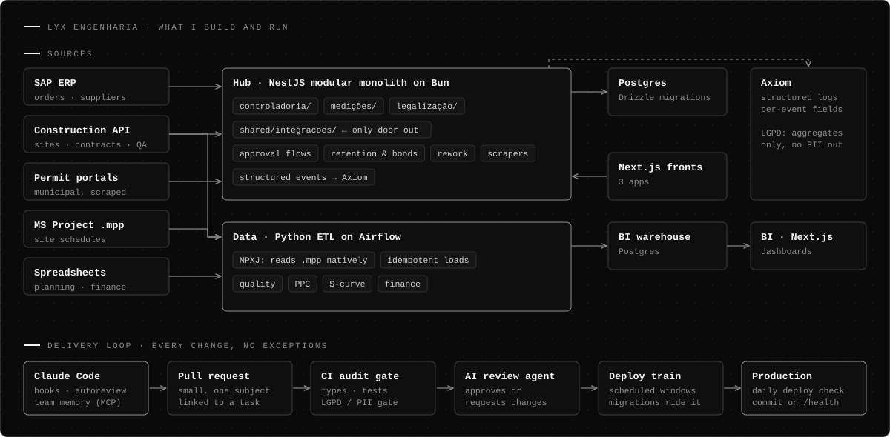
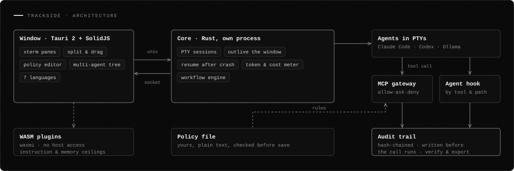

<picture>
  <source media="(prefers-color-scheme: light)" srcset="./assets/terminal-light.svg">
  
</picture>

I build production systems end to end: backend, data pipelines, BI, and the AI agents that sit
inside the delivery loop. Most of my time goes into the unglamorous parts that make speed safe:
gates, evals, audit trails, ways back.

[tracksidehq.dev](https://tracksidehq.dev) · [enzokoeche.vercel.app](https://enzokoeche.vercel.app) · [LinkedIn](https://www.linkedin.com/in/enzo-koeche-castagna-82ab6137b/) · [koechecastagnaenzo@gmail.com](mailto:koechecastagnaenzo@gmail.com)

---

## Now · Lyx Engenharia

Internal platform for one of southern Brazil's largest homebuilders. I own it from the source
system to the screen:

- **Hub (backend).** NestJS modular monolith on Bun and Postgres. I own two modules end to end:
  **Controladoria** (cost control: purchase-order approval flows, retention and performance bonds,
  rework) and **Medições** (contractor progress measurement), plus their Next.js fronts. The ERP and
  the construction-management platform are reached through one integration layer and nowhere else.
- **Data.** Python ETL on Airflow feeding the BI warehouse. Site schedules are read straight from
  the MS Project files (MPXJ) instead of spreadsheet exports, so S-curves and task plans come from
  the source of truth. Planning, quality and PPC dashboards in Next.js.
- **Regulatory.** Took over the regulatory-intelligence platform: scrapers for municipal permit
  portals and change detection on legislation pages.
- **Delivery.** In the group that signs off the daily production deploy. Every change goes through
  a CI audit gate (types, tests, an LGPD/PII gate), an AI review agent and a scheduled deploy train.
  Structured events go to Axiom; production is read in aggregate only.

<picture>
  <source media="(prefers-color-scheme: light)" srcset="./assets/lyx-light.svg">
  
</picture>

```text
merged PRs · 2026-09-06 → 2026-11-16                 670
  hub backend           NestJS · Bun · Drizzle        260
  controladoria front   Next.js                       175
  BI + ETL              Next.js · Python · Airflow    164
  medições front        Next.js                        48
  regulatory front      Next.js                        22
  other                                                 1
```

That pace is possible because of the harness I built around Claude Code for this work:

- **Hooks that say no.** A push only goes through with a green audit of that exact content; a PR
  can't be opened without a linked task.
- **Review before review.** A subagent runs the review bot's own playbook on my diff before the PR
  exists, so the bot's first pass is a formality.
- **A failed read is not a state.** State verifiers report "couldn't read" instead of "all green".
  Monitors that lie are worse than no monitors.
- **Memory that outlives the session.** Shared team memory over MCP: one fact per page, decisions,
  gotchas and domain concepts, queried before anyone reopens a settled question.
- **Routines nobody has to remember.** launchd jobs for the daily deploy check, the CI watcher and a
  cross-repo review every three days, with the model sized to the task.

---

## Building · Trackside

**[tracksidehq.dev](https://tracksidehq.dev)**. A desktop workbench for AI coding agents: run Claude
Code, Codex and local models side by side on the same task, decide what each one may do, and keep a
record of every tool call it judges. Runs on your machine. No account, no cloud, no telemetry.

<picture>
  <source media="(prefers-color-scheme: light)" srcset="./assets/trackside-light.svg">
  
</picture>

- **Core in its own process.** Rust, talking to the window over a Unix socket with a versioned
  protocol. Close the window and the sessions keep running; kill the core and the terminals come
  back from disk.
- **Policy in front of every tool.** An MCP gateway (allow, ask, deny per tool, denied tools hidden
  from the agent, tool definitions pinned by hash) plus an agent hook for the agent's own tools, by
  name and by file path.
- **Audit first, act second.** Every decision is written to a hash-chained trail before it takes
  effect. Verify the chain, export it.
- **Plugins that can't reach anything.** WebAssembly in an interpreter with no host access and hard
  ceilings on instructions and memory.
- **Honest status.** The README says what has been proven against real agents and what hasn't.

```text
week one        471 commits · 107 merged PRs · 61 ADRs · 500+ tests
stack           Rust · Tauri 2 · SolidJS · xterm.js · wasmi · portable-pty
interface       en · pt-BR · es · de · fr · zh-CN · ja
source          closed · early access at tracksidehq.dev
```

---

## How I work

- **A system that doesn't know says so.** "I didn't find it" is enforced by a test, not a prompt.
- **Not measured, not done.** Evals in CI, cost and latency tracked. "Seems better" is not a result.
- **Every change has a way back.** Migrations, deploys, registry tweaks. If it can't be undone, it
  isn't finished.
- **People own decisions about money, credit and compliance.** Agents prepare, a person approves,
  and the interrupt is in the code.
- **Personal data comes with a plan.** Portfolio work runs on synthetic data; production is read in
  aggregate.

## Public work

| | | |
|---|---|---|
| **[rag-conformidade-laticinios](https://github.com/EnzoKoeche/rag-conformidade-laticinios)** | Corrective RAG for dairy compliance: hybrid retrieval, local rerank, citations verified against the source, refusal when there is no basis. Eval-first. | `Python` `LangGraph` |
| **[agente-credito-langgraph](https://github.com/EnzoKoeche/agente-credito-langgraph)** | Consumer-credit analysis agent: typed state, checkpointing, human-in-the-loop interrupt, evals in CI. | `Python` `LangGraph` |
| **[enzokoeche-site](https://github.com/EnzoKoeche/enzokoeche-site)** | Portfolio with an in-browser BM25 agent (cited answers, honest refusal, 19-case eval) and live GitHub telemetry. | `Next.js` `TypeScript` |
| **[shadowmesh](https://github.com/EnzoKoeche/shadowmesh)** | AI security control plane: discovers, classifies and governs AI tool usage across an organisation. | `Python` |
| **[soulstone](https://github.com/EnzoKoeche/soulstone)** | Live Steam Market price tracker for a game community. Public market data only. | `React` `Supabase` |
| **[fpsbooster](https://github.com/EnzoKoeche/fpsbooster)** | Windows latency optimiser: hardware detection, suggested tweaks, every change reversible. | `C#` `.NET 8` `WPF` |

## Toolbox

```text
languages   TypeScript · Python · Rust · SQL · C#
backend     NestJS · Bun · Node · FastAPI · Postgres · Drizzle · Prisma
data        Airflow · pandas · MPXJ · Power BI
frontend    Next.js · React · SolidJS · Tailwind
desktop     Tauri 2 · WebAssembly · .NET
ai          Claude Code · MCP · LangGraph · RAG · evals
ops         Docker · Dokploy · GitHub Actions · Vercel · Axiom
```

<sub>No widgets. The terminal and both diagrams are drawn by <a href="scripts/gen_profile.py"><code>gen_profile.py</code></a>, in light and dark, and committed here.</sub>
